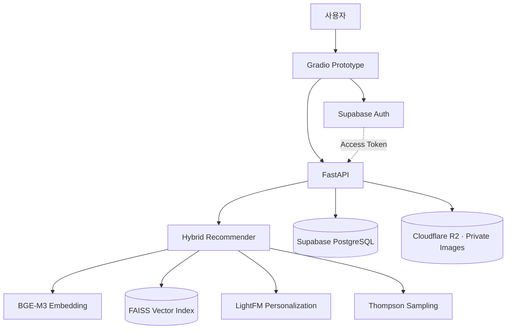

<div align="center">

# 🎬 MUZZAL

### 말 대신 짤로 통하는 우리들의 커뮤니티

**맥락을 읽는 AI 추천부터, 나만의 짤 보관함과 함께 쓰는 채팅방까지.**  
**Infinite Challenge Meme Recommendation & Community Platform**


**[프로젝트 소개](#-project-overview) · [핵심 기능](#-key-features) · [아키텍처](#-system-architecture) · [개발 현황](#-development-status) · [로컬 실행](#-getting-started)**

## 👥 Team RS

**김정호 · 김해나 · 문유하 · 송민승**  
Jeongho Kim · Hannah Kim · Yooha Moon · Minseung Song

국민대학교 **D&A × X:AI × Wink — 2nd D&X:W Conference / AI Tech Track**
</div>

---

## ✨ 한 줄 소개

> **“지금 이 감정, 무한도전 짤 하나로 설명할 수 있다면?”**

MUZZAL은 사용자가 입력한 **감정·상황·문맥**을 이해해 어울리는 무한도전 짤을 추천하고, 마음에 드는 짤을 저장하거나 다른 사용자와 공유할 수 있도록 설계한 AI 기반 커뮤니티 서비스입니다.

검색 결과를 보여주는 데 그치지 않고 **의미 기반 검색 → 개인화 랭킹 → 선택·저장·전송 → 사용자 피드백**으로 이어지는 추천 경험을 지향합니다.

> 🎓 국민대학교 **제2회 D&X:W Conference** AI Tech Track · **Team RS** 출품작  
> 주최 학회: **D&A** (빅데이터 분석 학회) · **X:AI** (인공지능 학회) · **Wink** (웹 학술동아리)

## 🌐 Project Overview

| 항목 | 내용 |
| :-- | :-- |
| **서비스** | 무한도전 짤 추천 및 커뮤니티 **MUZZAL** |
| **문제 정의** | 짤의 자막만으로는 반어적 표현, 표정, 상황적 의미를 충분히 검색하기 어려움 |
| **접근 방법** | 이미지의 의미 정보를 텍스트 검색과 결합하고, 사용자 선호와 피드백을 추천에 활용 |
| **사용 경험** | 텍스트 입력 → 추천 짤 탐색 → 미리보기 → 보관함 저장·전송 |
| **개발 단계** | **로컬 프로토타입 및 채팅 백엔드 검증 완료 / 웹 서비스 공개 배포 준비 중** |

## 🚀 Key Features

### 01. 맥락 기반 짤 추천 · Semantic Recommendation

단순한 키워드 매칭이 아니라 사용자의 감정과 상황을 임베딩 공간에서 비교해 관련성이 높은 짤을 검색합니다.

- **BGE-M3** 기반 한국어 질의 임베딩
- **FAISS**를 활용한 벡터 유사도 검색
- 이미지 속 표정·상황·자막 등의 의미 정보를 활용하는 검색 파이프라인
- 추천 짤 **8개** 미리보기 및 선택

### 02. 개인화 추천 · Personalized Ranking

- **LightFM** 기반 사용자 선호 점수 결합
- **Thompson Sampling**으로 추천 혼합 비율(`α`) 선택
- 기존 추천 모델의 프로필 ID(`U101` 등)와 실제 로그인 사용자의 UUID를 구분

> **개발 참고:** 추천 행동의 Supabase 이벤트 적재 및 Bandit 통계 DB 연동은 후속 과제입니다. 현재 개인화 모델이 모든 신규 로그인 사용자에게 학습 완료된 것은 아닙니다.

### 03. 나만의 짤 보관함 · Saved Memes

- **Supabase Auth** 로그인 및 토큰 기반 API 인증
- **저장 / 조회 / 저장 취소** 기능
- 계정별 보관함 데이터 분리 및 재로그인 후 유지
- **Cloudflare R2**의 비공개 이미지 객체를 FastAPI 이미지 API로 제공

### 04. 공유 채팅방 · Community Chat

- 공개 채팅방 생성·탐색·입장·퇴장
- 텍스트 및 무도짤 이미지 메시지 전송 API
- **Supabase PostgreSQL + RLS** 기반 참여자별 메시지 접근 제어
- **퇴장한 사람의 방 목록에서만 제거**, 남은 사용자의 대화 기록 유지
- **재입장 시 이전 대화 비공개**, 재입장 이후 메시지만 조회

> **구현 구분:** 채팅 **DB·API는 A/B 계정 통합 테스트 완료**. 여러 브라우저에서 공유 채팅이 실시간으로 표시되는 **Gradio UI 연동은 개발 예정**입니다.

## 🏗️ System Architecture



**주요 데이터 흐름**

```text
사용자 텍스트 입력
       ↓
한국어 의미 임베딩 (BGE-M3)
       ↓
유사 짤 후보 탐색 (FAISS)
       ↓
개인화 점수 결합 (LightFM)
       ↓
혼합 비율 선택 (Thompson Sampling)
       ↓
추천 이미지 표시 (FastAPI + R2)
       ↓
사용자 선택 · 저장 · 채팅 전송
```

### Tech Stack

| 영역 | 기술 |
| :-- | :-- |
| **AI / Recommendation** | BGE-M3 · FAISS · LightFM · Thompson Sampling |
| **Backend** | Python 3.11 · FastAPI |
| **Frontend (Prototype)** | Gradio |
| **Authentication** | Supabase Auth |
| **Database & Access Control** | Supabase PostgreSQL · Row Level Security (RLS) |
| **Image Storage** | Cloudflare R2 (private bucket) |
| **Future Frontend** | Next.js 기반 웹 UI 계획 |


## 📍 Development Status

| 기능 | 상태 |
| :-- | :-- |
| 의미 기반 검색·추천 API | ✅ 구현 및 로컬 검증 |
| R2 이미지 로딩 | ✅ 구현 및 로컬 검증 |
| Supabase 로그인·보관함 | ✅ 구현 및 로컬 검증 |
| 채팅방·메시지 API 및 RLS | ✅ A/B 통합 테스트 통과 |
| Gradio 추천·보관함 UI | ✅ 로컬 검증 |
| Gradio 다중 사용자 공유 채팅 | 🚧 개발 예정 |
| 추천 이벤트·Bandit 통계 DB 적재 | 📋 계획 |
| Next.js UI 및 클라우드 공개 배포 | 📋 계획 |

## 🧑‍💻 Getting Started

>TBH

## 🗺️ Roadmap

- [x] 맥락 기반 추천 엔진 및 개인화 랭킹
- [x] 이미지 저장소 분리 및 FastAPI 이미지 제공
- [x] Supabase 사용자 인증 및 보관함 연동
- [x] 채팅 API · 참여자 RLS · 퇴장/재입장 접근 제어
- [x] A/B 계정 통합 테스트
- [ ] **Gradio 공유 채팅 연결** — 방 탐색·입장·나가기 및 메시지 갱신
- [ ] 추천 이벤트 로깅 및 Bandit DB 영속화
- [ ] Next.js 웹 UI 구현
- [ ] Docker·클라우드 배포 및 운영 모니터링


---

<details>
<summary>🇺🇸 English Summary</summary>

### MUZZAL — The Meme-Only Conversation Platform

MUZZAL is an AI-powered *Infinite Challenge* meme recommendation and community platform presented by **Team RS** at Kookmin University's **2nd D&X:W Conference**.

The service retrieves contextually relevant memes with **BGE-M3 + FAISS**, incorporates preference signals with **LightFM**, and explores ranking mixtures with **Thompson Sampling**. **FastAPI** powers the recommendation and image endpoints, **Supabase** provides authentication and persistent user data, and **Cloudflare R2** stores images privately.

**Verified locally:** personalized meme storage, token-based access control, and multi-user chat backend workflows—including leave/rejoin behavior that preserves other participants' history while hiding past messages from returning members. **In progress:** connecting the shared chat experience to the Gradio UI and preparing public deployment.

</details>

<div align="center">

**Because sometimes, one meme says it better than a thousand words. 🎞️**

</div>
